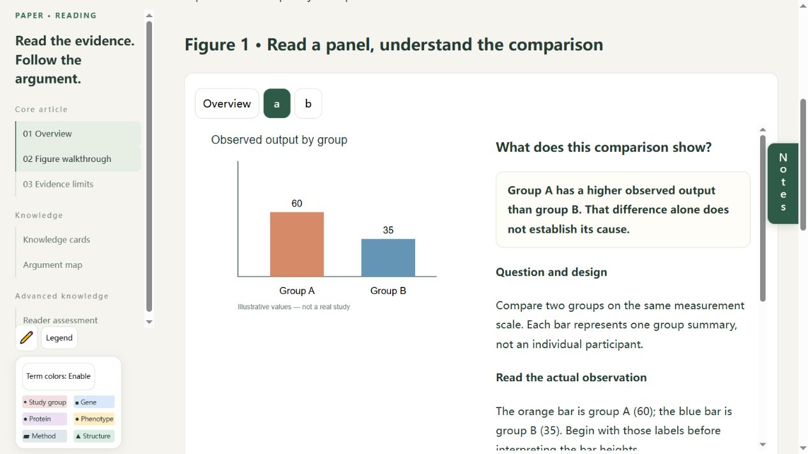
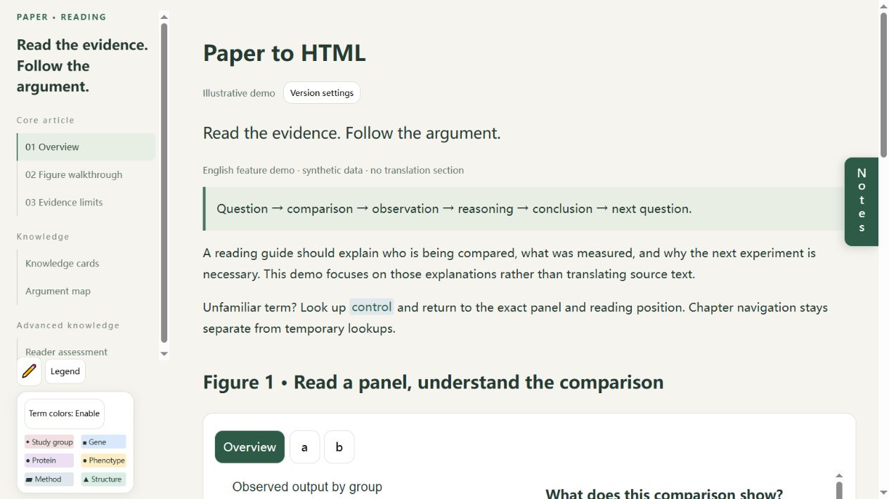
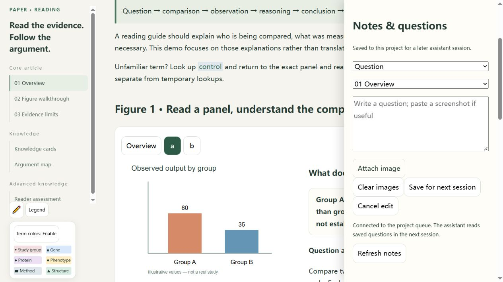

<div align="center">

**[简体中文](README.md) · English**


### A paper walkthrough you can follow

Read the text. Understand each figure. Look up a term and return to your place.

[](https://github.com/BerryIcey/paper-to-html/releases/tag/v2.1)
[](LICENSE)

**[Download v2.1](https://github.com/BerryIcey/paper-to-html/releases/download/v2.1/paper-to-html-v2-v2.1.zip) · [Read the Skill](https://github.com/BerryIcey/paper-to-html/tree/v2.1/skills/paper-to-html-v2/SKILL.md) · [Release notes](docs/v2.1-changes.md) · [Report an issue](https://github.com/BerryIcey/paper-to-html/issues)**

</div>

## See the reading experience

Switch the figure and explanation together. Understand what each element represents before deciding what the evidence supports.



<details>
<summary>Show the overview and notes panel</summary>




</details>

[Download the English demo HTML](https://raw.githubusercontent.com/BerryIcey/paper-to-html/main/demo/en/paper-reading.html), save it, and open it in a browser. The demo uses original text and simulated data. GitHub's HTML file page shows source code. Saving project notes requires a local service. This separate English demo does not promise a fully English-localized generation workflow; the released Skill is Chinese-first.

## What you get

| Read the text | Read the evidence | Look up and keep notes |
|---|---|---|
| Continuous source and core translations | All main panels with guided explanations | Colored terms and knowledge cards |
| Clear findings and detailed reasoning | Questions, legends, observations and inference | Return to the previous reading position |
| Argument map and closing assessment | Explicit evidence limits | Highlighting, zoom and queued notes |

This repository provides a **Codex Skill and HTML reader components**. It guides an assistant; it is not a standalone system that automatically understands arbitrary papers. Generated explanations need source review.

## Start in three steps

### 1 · Install the recommended release

Download [paper-to-html-v2-v2.1.zip](https://github.com/BerryIcey/paper-to-html/releases/download/v2.1/paper-to-html-v2-v2.1.zip). Place its complete `paper-to-html-v2` folder in your configured Codex Skill directory, commonly `~/.codex/skills/`. Back up an existing installation outside that directory first, then start a new chat to confirm discovery.

The release is **v2.1**; the invocation remains **`$paper-to-html-v2`**. Repository updates do not automatically update installed copies.

### 2 · Provide a paper

```text
$paper-to-html-v2
Create a Chinese HTML walkthrough of this paper.
Translate the core text, explain every main figure panel,
and show how the paper's argument develops.
```

Use a PDF you are entitled to provide. The default includes the core text, main figures, necessary knowledge cards and a closing assessment. Detailed Methods references, supplementary walkthroughs and quizzes can be requested separately. Missing source materials should be disclosed.

### 3 · Read and continue

The static HTML supports offline panel switching, zoom, cards and highlighting. Open the paper's local service to save project notes for a later assistant session. Notes **do not trigger an instant GPT response**. Browser drafts and project notes are separate stores.

<details>
<summary>Try the components without a model</summary>

Requires Python, but no OpenAI API key:

```sh
git clone https://github.com/BerryIcey/paper-to-html.git
cd paper-to-html
python skills/paper-to-html-v2/assets/reader-components/reading_server.py --root demo/en --port 18765
```

Open `http://127.0.0.1:18765/paper-reading.html` on the same machine. This is a temporary demo service; paper projects need a suitable independent background service.

</details>

## Versions

| Version | Status | What it contains |
|---|---|---|
| **v2.1** | **Latest recommended · Released** | [Download](https://github.com/BerryIcey/paper-to-html/releases/tag/v2.1) · [Change report](docs/v2.1-changes.md): complete panel explanation requirements, adaptive concepts and knowledge cards, lookup links in source text and captions |
| v2.0.2 | Historical | [Snapshot](https://github.com/BerryIcey/paper-to-html/tree/v2.0.2) · [Earlier changes](docs/v2-changes.md) |
| v1.0.0 | Original | [Snapshot](https://github.com/BerryIcey/paper-to-html/tree/v1.0.0), retained for comparison and rollback |

**v2.2 is under local testing and has not been publicly released.** Its undergraduate reader baseline and further cross-domain adaptations are not included in the v2.1 package. Skill versions and individual paper-reader versions are independent.

[v2.1 checksum](https://github.com/BerryIcey/paper-to-html/releases/download/v2.1/paper-to-html-v2-v2.1.sha256) · [Compare versions](https://github.com/BerryIcey/paper-to-html/compare/v2.0.2...v2.1). Do not mix reference files from different versions.

## Practical limits

- **Environment:** A Skill-capable assistant with PDF access; Python for components and services, PyMuPDF for figure crops, and Node.js for JavaScript checks.
- **Review:** Translations, labels, numbers and inferences need source checks. Passing tests does not establish scientific accuracy, comprehension or coverage of every discipline.
- **Persistence:** Project notes need the local service. Automatic offline retry, cross-device sync and instant model responses are not implemented.
- **Access:** `127.0.0.1` is local to each device. Offline reading on a phone does not connect it to a computer's loopback server.
- **Versions and background services:** Projects can keep zero, one or two historical copies in addition to the latest. Background startup differs by operating system; actual restart survival requires separate verification.

## Help improve it

[Report an issue](https://github.com/BerryIcey/paper-to-html/issues) with the version, browser, expected and observed behavior. For explanation problems, identify the object, comparison or inference that remains unclear.

Current priorities: missed specialist concepts, excessive basic explanations, consistent quality across long papers, touch interaction and different forms of argument. Do not upload private notes, credentials or paper full texts without permission.

Code and general documentation use the [MIT license](LICENSE). Papers and third-party images retain their applicable rights; user papers are not distributed here.
