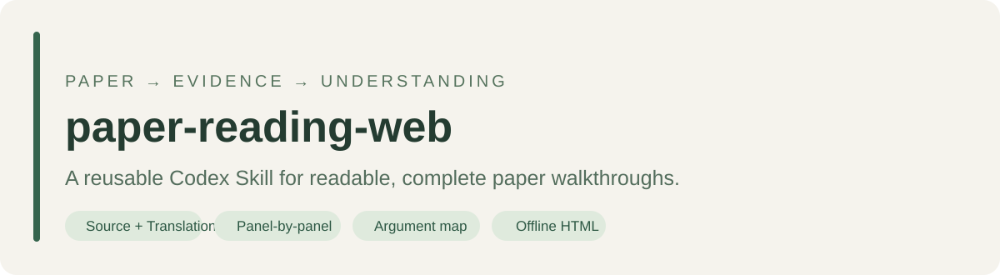
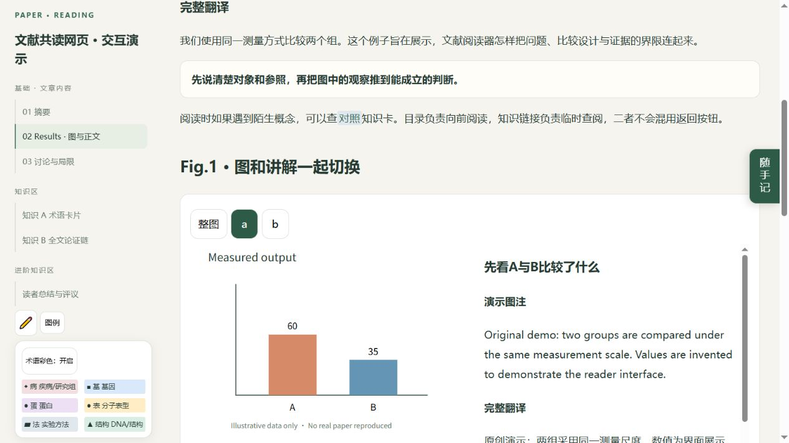
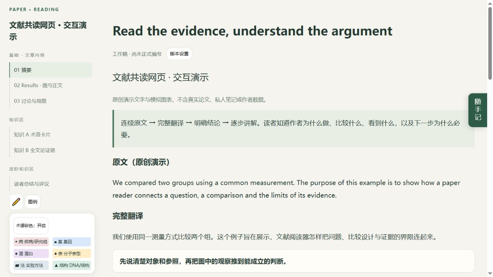
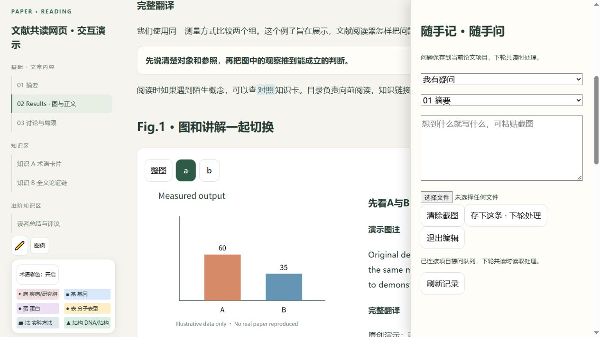

<div align="center">

**简体中文 · [English](README.en.md)**



**把一篇论文，变成能顺着读、看懂每张图、知道证据边界的中文网页。**

A reusable **Codex Skill + HTML reader toolkit** for source-faithful, panel-by-panel paper walkthroughs.

[](LICENSE)
[](#能做什么)
[](skills/paper-reading-web-v2/SKILL.md)

[下载 v2](https://github.com/BerryIcey/paper-reading-web/releases/latest) · [查看 Skill](skills/paper-reading-web-v2/SKILL.md) · [体验演示](#先看效果) · [反馈问题](https://github.com/BerryIcey/paper-reading-web/issues)

</div>

## 为什么做这个项目

论文讲解常见的问题不是没有文字，而是读者还得自己猜：这个点代表谁？高低相对哪组？为什么做下一项实验？

这个项目把逐问逐答中有效的讲法做成可复用规范：**问题 → 比较设计 → 真实观察 → 中间推理 → 能支持的结论 → 下一缺口**。网页组件则解决来回翻页、逐图切换、查术语后找不到阅读位置等问题。

它是一套让 Codex 制作阅读网页的 Skill，并配有真实组件与检查脚本。它不会脱离助手自动读懂任意PDF，也不保证生成内容免审查。

## 先看效果

下面使用原创演示文字与模拟图表，不包含真实论文或私人阅读记录。



<details>
<summary>查看全文入口与随手记界面</summary>




</details>

[下载并打开演示 HTML](demo/paper-reading.html)。在仓库里点击 HTML 是源码预览；下载后用浏览器打开。静态演示可切图、缩放、查卡和返回；项目笔记需要启动本地服务。

## 能做什么

| 阅读需要 | 输出/交互 |
|---|---|
| 读正文 | 连续原文、核心完整翻译、明确结论、自然详细解释 |
| 读每个小图 | 总览 + 全部主图面板，图注/翻译/局部图例/真实数据带读 |
| 跟上作者的问题 | 全文论证链与流程框图，解释上一结果为何不够 |
| 超出作者叙事 | 文末独立读者评议：创新、可信结论、局限与另一视角 |
| 查陌生词 | 术语卡居中展开，临时查阅后精确返回原面板和滚动位置 |
| 保持阅读流畅 | 左图右文、独立文字滚动、手机/平板面板切换 |
| 做个人标记 | 显式荧光笔开关、撤销、独立术语纯净模式 |
| 保存下轮问题 | 右侧可拖动书签，文字/截图写项目队列，下轮助手读取 |
| 管理交付 | 桌面固定最新版，项目保留当前版 + 0/1/2 个历史备份 |

首次默认生成完整核心；独立Methods、附图详解、复习等按需选择。区域顺序为基础文章、知识、进阶内容、进阶知识；文末读者评议默认必需。不要把“进阶知识区”误解成其中所有内容都可选。

## 快速开始

### 1. 安装 v2

从 [Releases](https://github.com/BerryIcey/paper-reading-web/releases/latest) 下载 `paper-reading-web-v2.zip`，解压后把完整 `paper-reading-web-v2` 文件夹放到 Codex 用户 Skill 目录中（通常为 `~/.codex/skills/`，以当前环境配置为准）。下一轮或新聊天确认 Skill 可用。

也可以克隆本仓库，复制 `skills/paper-reading-web-v2/`。若已有旧安装，先在 Skill 扫描目录之外保留备份，避免两套名称同时自动匹配。GitHub 更新不会自动同步各设备安装。

### 2. 给 Codex 一篇论文

```text
$paper-reading-web-v2
把这篇论文做成基础版HTML共读网页，所有主图逐面板讲清楚。
请按照Skill检查正文解析、读图与全文论证链，不压缩后半部分。
```

提供有权使用的PDF。助手会重新建立本文证据台账和图清单，不继承演示或上一论文的数据。缺来源/补充材料会说明范围。

### 3. 阅读与继续

日常看桌面同名最新版。需要随手记时打开当前论文的本地阅读服务；问题写项目，由下一轮助手读取处理，**不是点击后即时GPT回复**。

首次本地启动选择覆盖或1/2个历史备份。离线HTML只展示导出时的策略，设置修改以项目文件为准。未选择仍可交付带时间标签的工作版，不删除历史。

## 只体验组件

下面不需要模型，运行原创演示的本地服务：

```sh
git clone https://github.com/BerryIcey/paper-reading-web.git
cd paper-reading-web
python skills/paper-reading-web-v2/assets/reader-components/reading_server.py --root demo --port 18765
```

打开 `http://127.0.0.1:18765/paper-reading.html`。这是临时演示服务；正式文献项目按维护规范配置独立后台。项目队列在本机保存，不需要OpenAI API密钥。

## 版本与更新

| 版本 | 路径 | 用途 |
|---|---|---|
| v1.0.0 | [paper-reading-web](skills/paper-reading-web/SKILL.md) | 定稿前原始快照，独立保留、用于对比 |
| v2.0.1 | [paper-reading-web-v2](skills/paper-reading-web-v2/SKILL.md) | 推荐版：消除旧规则冲突，整理现行规范并修复发布设置断点 |

v1保留当时内容，包含已经被v2替代的规则；不要混合使用两个版本的参考文件。未来更新集中在本项目，[个人Skill库](https://github.com/BerryIcey/my-skills)只保留项目入口。

详细差异见 [v2 变更说明](docs/v2-changes.md)。下载包各自只有一个技能根目录，并提供SHA-256校验。Skill的v2与某篇文章的交付版本号互相独立。

## 依赖与限制

- 制作完整论文网页需要支持 Skill 的助手、可读取PDF的环境和必要图像工具。组件、装配、发布及本地服务脚本使用 Python 标准库；PDF矢量裁图脚本需 PyMuPDF。运行语法检查需 Node.js。
- 原文翻译、统计、图例和科学判断必须逐单元核对；结构测试通过不证明用户理解或事实完全正确。
- 静态全文不依赖CDN；个人标黄及草稿存浏览器，服务端随手记/设置存项目。当前未实现断线自动补存、跨设备同步或即时GPT问答。
- loopback只供同一台设备访问。手机离线切图可用，不代表手机能提交到电脑的127.0.0.1；安全网络发布需另行配置。
- Windows独立后台方案使用当前用户任务与守护程序；其他平台需选适用运行方式。自动恢复与真正重启存活分别验证。
- 软件代码与通用规范使用MIT许可。用户提供论文、第三方图片和生成的论文内容仍受其原有权利及使用条件约束，本仓库不分发它们。

## 帮助它变好

欢迎提交真实的可复现问题：哪个版本、哪类图、期望行为、实际表现，以及可公开的最小截图。请不要上传私人笔记、账号信息或未经许可的论文全文。

优先改进方向：首次读者能否复述比较与理由、全量生成后半部分是否降质、触控实际操作、不同学科图例适配。

如果这个工具帮你读懂了一篇论文，欢迎 Star；更有用的是告诉我们哪一处解释仍然让你需要猜。

---

**English:** This repository provides versioned Codex Skills and reusable HTML reader components for Chinese-first research-paper walkthroughs. It emphasizes complete core text translation, local legend mapping, real-observation reasoning, explicit argument transitions and evidence limits. The demo is synthetic; no private notes or full papers are included. Local notes are queued for a later assistant session, not sent to an instant model API.
